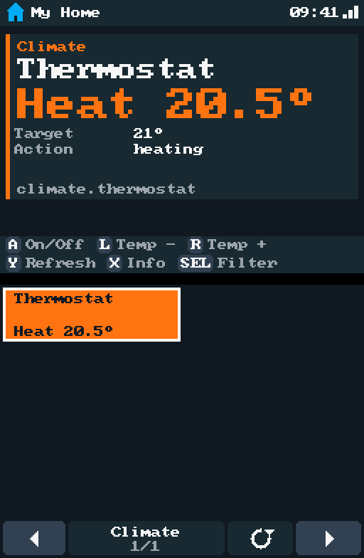
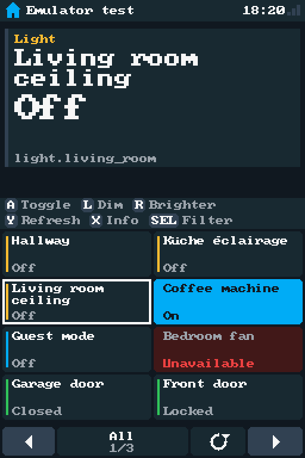
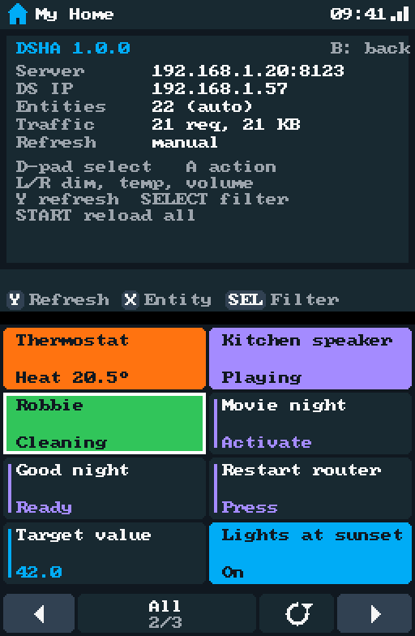

# DSHA — Home Assistant for the Nintendo DS

Control your smart home from a Nintendo DS. DSHA is a native `.nds` homebrew
app that talks directly to your [Home Assistant](https://www.home-assistant.io/)
server over WiFi: toggle lights, dim them, change the thermostat, open the
garage, lock the door, run scenes and read your sensors — with the touch screen
or the buttons.

<p align="center">
  
  
  
</p>

- **Native DS app**: written in C with [BlocksDS](https://blocksds.skylyrac.net),
  runs on real hardware (DS, DS Lite, DSi, 3DS) and emulators.
- **Touch dashboard**: 8 tiles per page, tap to toggle, colors show what's on.
- **Big details view** on the top screen with the relevant controls for each
  entity type.
- **Works with big installations**: the JSON parser streams the response, so
  thousands of entities don't need to fit in the DS's 4 MB of RAM.
- **Auto refresh** of the visible entities, keep-alive HTTP connections.
- **Offline demo mode** to try it without a server.
- **Open source** (MIT), with desktop unit tests and a fake Home Assistant
  server for development.

## Contents

- [Requirements](#requirements)
- [Quick start](#quick-start)
- [Controls](#controls)
- [Supported entities](#supported-entities)
- [Configuration](docs/configuration.md)
- [Troubleshooting](docs/troubleshooting.md)
- [Building from source](docs/building.md)
- [How it works](docs/architecture.md)
- [Contributing](CONTRIBUTING.md)

## Requirements

**Console** — any of these:

| Console | WiFi security supported | Notes |
|---|---|---|
| DS / DS Lite | Open, WEP | Needs a flashcart (R4, Acekard, DSTT...). Most home routers use WPA2, so you may need a separate open/WEP guest network or a travel router. |
| DSi / DSi XL | Open, WEP, **WPA2** | Run it from the SD card with [TWiLight Menu++](https://github.com/DS-Homebrew/TWiLightMenu) or Unlaunch (DSi mode). |
| 3DS / 2DS | Open, WEP (WPA2 in DSi mode: untested) | Run it with TWiLight Menu++. Reports welcome! |
| Emulators | — | melonDS (with WiFi emulation) or the offline demo in any emulator. |

**Home Assistant** — any recent version, reachable on your local network over
plain HTTP (the default `http://<ip>:8123`). You need a
[long-lived access token](#2-create-a-token).

## Quick start

### 1. Get `dsha.nds`

Download `dsha.nds` from the
[Releases page](https://github.com/semluvsfood/dsha/releases), or
[build it yourself](docs/building.md).

### 2. Create a token

In Home Assistant, click your **user name** (bottom left) → **Security** tab →
**Long-lived access tokens** → **Create token**. Name it "Nintendo DS" and copy
the token (you only see it once).

### 3. Write the config file

Create a file called `config.ini` in a folder called `dsha` on your SD card
(so the path is `/dsha/config.ini`):

```ini
host = 192.168.1.10
token = eyJhbGciOiJIUzI1NiIsInR5cCI6IkpXVCJ9...
```

Use the **IP address** of your Home Assistant server (you can see it in
Settings → System → Network). That's all that is required.
[`config.example.ini`](config.example.ini) shows all the options, like picking
which entities to show or using a specific WiFi network.

### 4. Set up WiFi on the console

DSHA uses the WiFi connections saved in the console:

- **DS / DS Lite**: start any game with Nintendo WFC support (Mario Kart DS,
  Pokémon...) and set up a connection under *Nintendo WFC Settings*.
- **DSi**: *System Settings → Internet → Connection Settings*. WPA2 networks
  go in the *Advanced Setup* slots 4-6.
- **3DS**: set up a connection in the *Nintendo WFC Settings* of any DS game
  (DS-mode connections only support open and WEP networks).

Or put `wifi_ssid` and `wifi_password` in `config.ini` instead.

### 5. Run it

Copy `dsha.nds` to the SD card and start it from your flashcart menu or
TWiLight Menu++. It connects to WiFi, loads your entities and shows the
dashboard.

> **Tip**: no server yet? Start DSHA without a config file and press **A** to
> try the offline demo.

## Controls

| Input | Action |
|---|---|
| **Tap a tile** | Toggle / run it (lights, switches, scenes...) |
| **Hold a tile** | Select it without toggling |
| **D-pad** | Move the selection (left/right at the edge changes page) |
| **A** | Main action of the selected entity (toggle, lock/unlock, play/pause...) |
| **L / R** | Decrease / increase: brightness, temperature, volume, cover close/open, number value |
| **Y** or ⟳ button | Refresh the entities on screen now |
| **SELECT** or the middle button | Filter: All, Lights, Switches, Climate, Covers & locks, Media, Scenes & scripts, Sensors |
| **◀ / ▶ buttons** | Previous / next page |
| **X** | Info panel (server, IP, traffic, help) |
| **START** | Reload all entities |
| **START + SELECT** (hold) | Exit |

The bottom of the top screen always shows what A, L and R do for the selected
entity.

## Supported entities

| Domain | Shows | A | L / R |
|---|---|---|---|
| `light` | On/off and brightness | Toggle | Dim / brighten (10% steps) |
| `switch`, `input_boolean`, `fan`, `automation`, `siren`, `humidifier` | On/off | Toggle | — |
| `climate` | Mode and current temperature, target, action | On/off | Target temperature −/+ |
| `cover` | Open/closed and position | Toggle | Close / open |
| `lock` | Locked/unlocked | Lock or unlock | — |
| `media_player` | State, title, volume | Play/pause | Volume −/+ |
| `vacuum` | State | Start / return to base | — |
| `scene`, `script` | — | Run | — |
| `button`, `input_button` | — | Press | — |
| `number`, `input_number` | Value and range | — | Value −/+ |
| `sensor`, `binary_sensor`, `weather`, `person` | State with units, friendly texts (Open/Closed, Detected/Clear...) | — | — |

Entities from other domains are shown (read only) when you list them with
`entity=` lines.

## Limitations

- **No HTTPS.** TLS on a 67 MHz CPU is slow and memory hungry, so DSHA talks
  plain HTTP. Use the local address of Home Assistant, not your Nabu Casa or
  other remote `https://` URL. Only use DSHA on a network you trust: the token
  travels unencrypted (as with any `http://` access to Home Assistant).
- **WPA2 only on DSi.** The original DS WiFi hardware only supports open and
  WEP networks. If your router is WPA2-only, use a DSi, or create an open/WEP
  guest network (ideally isolated, with only Home Assistant reachable).
- **No `.local` names.** mDNS isn't supported; use the IP address (normal DNS
  names work).
- At most 128 entities are shown. Use `entity=` or `domains=` to choose.
- The display is refreshed by polling (not the WebSocket API), only for the
  entities on screen.

## Project status

The app has been tested with the desktop test suite (HTTP client, streaming
parser and UI logic against a fake Home Assistant server) and the real `.nds`
has been run in an emulator in demo mode. See the
[changelog](CHANGELOG.md). Reports from real hardware are very welcome:
please [open an issue](https://github.com/semluvsfood/dsha/issues) with your
console model and how you launched DSHA.

<p align="center">
  
  
  
</p>

## License

DSHA is released under the [MIT license](LICENSE). The ROM includes libraries
from BlocksDS (libnds, DSWifi with lwIP and Mbed TLS) under their own
licenses; see [licenses/](licenses/README.md).

DSHA is not affiliated with Nintendo or with the Home Assistant project.
"Nintendo DS" is a trademark of Nintendo. "Home Assistant" is a trademark of
the Open Home Foundation.
