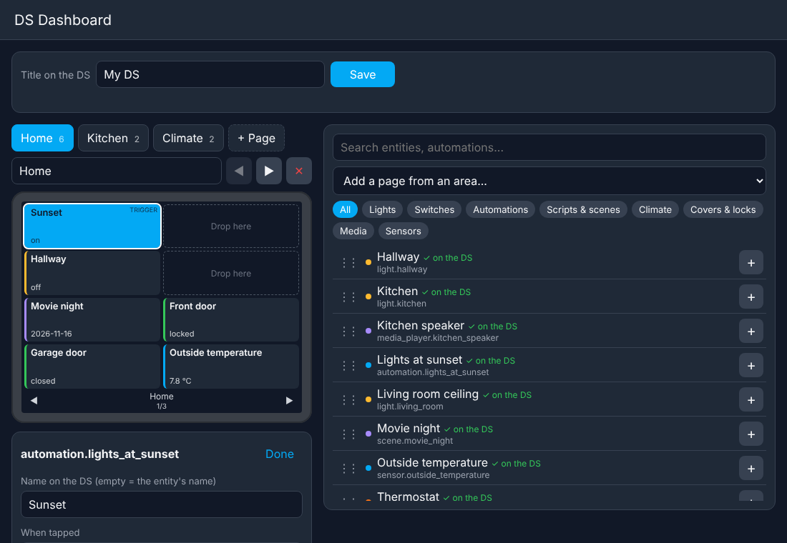

# DS Dashboard: the Home Assistant integration

DSHA comes with an optional **Home Assistant integration** that adds a
**DS Dashboard** page to the sidebar. There you decide exactly what your DS
shows: pages, the position of every tile, names and what tapping does, with
drag and drop. Your DS picks the layout up automatically.

Without the integration DSHA still works: it shows all your supported
entities grouped by type (or the `entity=` list of `config.ini`).

## Install

### With HACS (recommended)

1. In Home Assistant, open **HACS**.
2. Menu (⋮, top right) → **Custom repositories**.
3. Repository: `https://github.com/semluvsfood/dsha`, type: **Integration** →
   **Add**.
4. Search for **DSHA Nintendo DS Dashboard** in HACS and **Download** it.
5. **Restart** Home Assistant (*Settings → System → Restart*).
6. **Settings → Devices & services → Add integration** → search for
   **DSHA** → **Submit**.

The **DS Dashboard** item appears in the sidebar.

### Manually

1. Copy the folder `custom_components/dsha` of this repository into the
   `custom_components` folder of your Home Assistant configuration (create it
   if needed), so you have `config/custom_components/dsha/manifest.json`.
2. Restart Home Assistant.
3. **Settings → Devices & services → Add integration → DSHA**.

Requires Home Assistant 2024.7 or newer.

## Arrange your DS

Open **DS Dashboard** in the sidebar (admins only).

- The dark box is your DS's bottom screen: **8 tiles per page**, 2 columns,
  4 rows, exactly as the DS shows them.
- **Drag** an entity, automation, script or scene from the list on the right
  into a slot, or tap **+** to put it in the first free slot of the page.
- **Drag a tile** onto another slot to swap them, onto a **page tab** to move
  it to that page, or back onto the list to remove it.
- **Tap a tile** to edit it:
  - **Name on the DS** — a shorter name fits better on the small screen.
  - **When tapped** — *Default* (toggle / run / press, depending on the
    type), *Trigger* (automations: run the automation now instead of turning
    it on/off) or *Read only*.
  - *Move to page...* and *Remove*.
- **Pages**: *+ Page* adds one; the name box renames the current page; ◀ ▶
  reorder; ✕ deletes it. Up to 16 pages.
- **Add a page from an area** creates pages with the entities of one of your
  Home Assistant areas (controls first, then sensors). A quick way to start.
- **Title on the DS** replaces the title in the top bar of the DS.
- Press **Save**. On the DS, press **START** to load the new layout (or just
  restart DSHA).

Empty slots stay empty on the DS, so you can group things visually.

On a phone the panel stacks in one column; drag tiles by touching them and
list entries by their ⋮⋮ handle (or just use **+**).

## On the DS

When the integration has a layout with at least one tile, DSHA uses it
automatically:

- The page name is shown in the middle of the bottom bar. **SELECT**, the
  middle button or ◀ ▶ switch pages.
- Each page is refreshed with **one** small request (`/api/dsha/states`), so
  it's faster than without the integration, especially on big installations.
- Custom names and tap actions are used; *Trigger* tiles show **A: Run now**.

To ignore the layout on a DS (for example to see everything again), add
`use_layout = 0` to its `config.ini`.

## Permissions

- Only administrators can open the panel and save layouts.
- The DS can use any account, also a non-admin one (recommended). It only
  receives the states of the entities in the layout that the account is
  allowed to read.

## API

Used by the DS; documented for other clients and for development.

| Request | Answer |
|---|---|
| `GET /api/dsha/layout` | `{"version": 1, "revision": 3, "title": "...", "pages": [{"name": "...", "tiles": [tile or null, ... 8 items]}]}`. A tile is `{"entity_id": "...", "name": "...", "action": "default" \| "trigger" \| "none"}`. 404 if the integration isn't set up. |
| `GET /api/dsha/states` | States of all the entities of the layout, in the `/api/states` format but with only the attributes the DS uses. |
| `GET /api/dsha/states?page=N` | Same, for page N (0-based). |

Both need the usual `Authorization: Bearer <token>` header. The panel uses the
websocket commands `dsha/layout/get` and `dsha/layout/save` (admin).

The layout is stored in `config/.storage/dsha.layout`, so it is part of your
Home Assistant backups.

## Uninstall

Delete the integration in *Settings → Devices & services* (the panel
disappears) and remove it from HACS. The DS goes back to its normal mode.
